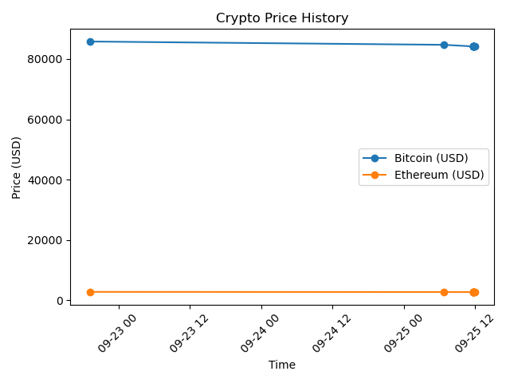

# Live Crypto Price ETL Pipeline

An end-to-end data pipeline that pulls live cryptocurrency prices, stores historical data in MySQL, analyzes trends using SQL, and serves the latest prices through a small Flask API.

## What it does

- **Extract:** Pulls live Bitcoin and Ethereum prices (USD + INR, plus 24h % change) from the [CoinGecko API](https://www.coingecko.com/en/api)
- **Load:** Inserts each pull into a MySQL database, timestamped, so history accumulates over time
- **Automate:** Runs automatically every 3 hours via cron
- **Analyze:** SQL queries — including `RANK()` and `PARTITION BY` — surface highest/lowest prices, price swings, and trends
- **Visualize:** A Python script (`plot_prices.py`) charts price history using matplotlib
- **Serve:** A Flask API (`api.py`) returns the latest price of each coin as JSON

## Tech stack

Python, MySQL, cron, matplotlib, Flask, pytest, CoinGecko API

## Architecture

CoinGecko API → Python (requests) → MySQL → SQL analysis + matplotlib chart, triggered every 3 hours by cron

MySQL → Flask API (`/prices`) → JSON

## Sample chart



*Note: prices look relatively flat in this sample — most data points were captured close together during testing. Over a longer running window, real price movement becomes visible.*

## Flask API: latest prices

The API reads the latest row for each coin from the `crypto_prices` table and sends it as JSON.

Run it, then open `http://127.0.0.1:5000/prices` in your browser:

```bash
python api.py
```

Example response (one coin shown):

```json
[
  {
    "change_24h_percent": -4.1,
    "coin": "bitcoin",
    "price_inr": 6082574.0,
    "price_usd": 64540.0,
    "recorded_at": "Sun, 15 Nov 2026 12:00:06 GMT"
  }
]
```

MySQL returns prices as text, so `clean_rows` converts them to numbers before they are sent. A pytest test checks this with a fake row, so it does not need a database:

```bash
python -m pytest
```

## Design decisions & tradeoffs

- **Cron over Airflow:** Airflow requires its own server/database to run, which is heavy infrastructure for a project this size. Cron fits the scale here; a production system with multiple dependent pipeline steps would justify Airflow's added complexity.
- **MySQL over a data warehouse:** A true warehouse (Snowflake/BigQuery) is built for large-scale analytical workloads. At this data volume, MySQL is sufficient and keeps the project simple; at scale, this would move to a proper warehouse.
- **Local cron limitation:** Since cron runs on a personal laptop rather than an always-on server, scheduled runs are skipped if the machine is asleep. In production, this pipeline would run on a cloud VM or server to guarantee uptime.
- **Flask development server:** The API uses Flask's built-in development server on my laptop, which is fine for learning. A real deployment would use a production server such as Gunicorn.

## Security

Database credentials are stored in a `.env` file (excluded from version control via `.gitignore`) and never hardcoded.

## Setup

1. Clone this repo
2. Create a virtual environment: `python3 -m venv venv`, then `source venv/bin/activate`
3. Create a `.env` file with `DB_PASSWORD=your_password`
4. Run `pip install -r requirements.txt`
5. Create the MySQL database/table (see schema below)
6. Run `python fetch_crypto.py` to pull data manually, or set up the cron job for automatic runs
7. Run `python api.py` to start the API

## Database schema

```sql
CREATE TABLE crypto_prices (
    id INT AUTO_INCREMENT PRIMARY KEY,
    coin VARCHAR(20),
    price_usd DECIMAL(18,2),
    price_inr DECIMAL(18,2),
    change_24h_percent DECIMAL(6,2),
    recorded_at DATETIME
);
```